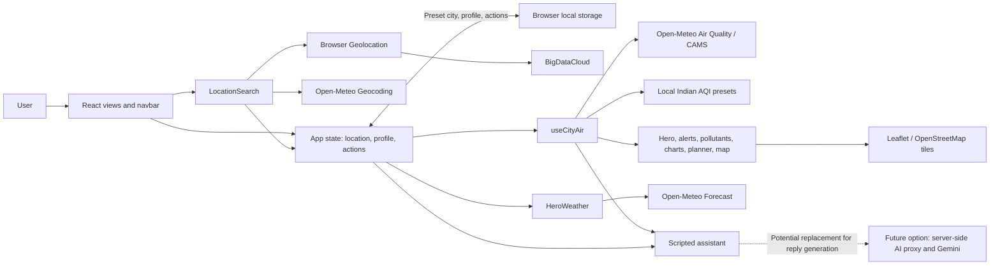

# Urban Air Quality Assistant technical context

## 1. Project identity

Urban Air Quality Assistant is a browser-based dashboard for checking outdoor air quality and planning daily activities around pollution. Urban smog can make it difficult to choose when to travel, exercise, ventilate a home, or move activities indoors. The project brings local AQI, pollutant concentrations, forecast trends, and practical guidance into one place.

The intended audience includes urban residents, commuters, caregivers, and households with children or older adults. The app aims to support informed decisions about exposure and lower-emission habits. The current assistant uses scripted advice tailored to the selected location and household profile. A prospective AI integration could explain the same data conversationally while retaining source attribution and clear uncertainty.

## 2. Technology stack

Versions below are the installed direct dependencies verified against the lockfile. The project uses JavaScript and JSX, with HTML and CSS.

| Area | Implementation |
| --- | --- |
| Frontend | React and React DOM 19.3.1, React Router DOM 7.18.6 with hash routing |
| Development and build | Vite 7.3.8, Vite React plugin 5.2.0, npm lockfile |
| Styling | Tailwind CSS and Tailwind Vite plugin 4.3.5, custom CSS, Inter Variable 5.3.0, Lucide React 0.562.0 |
| Motion | Motion 12.43.0, Web Animations API, Canvas 2D, CSS transitions and media queries |
| Charts | Recharts 3.11.0 |
| Maps | Leaflet 1.9.4 with OpenStreetMap tiles |
| Air quality and weather | Open-Meteo Air Quality using Copernicus CAMS, plus Open-Meteo Forecast |
| Location | Open-Meteo Geocoding using GeoNames, browser Geolocation, BigDataCloud reverse geocoding |
| Assistant | Local scripted JavaScript. No connected AI model or SDK |
| Backend, database, hosting | No backend, database, or deployment platform is configured in this workspace. Browser preferences use local storage |

## 3. System architecture

The Vite entry mounts a React single-page application. The browser calls public providers directly. App state is shared through component props. Searched and detected locations live in memory for the current page session. The preset city, household profile, and selected sustainability actions use the local storage keys `uaqa:city`, `uaqa:profile`, and `uaqa:actions`.



`useCityAir` keys responses by location ID, coordinates, and retry counter. It aborts superseded requests and exposes pending or unavailable data for the current location. The normalizer retains distinct current, earlier modeled, and forecast values. The hero's weather fetch is independent and keyed by coordinates. The assistant consumes the selected city and profile. A reply in flight is discarded if the coordinates change, with a prompt to send the question again.

### Routes

| Hash route | View |
| --- | --- |
| `#/` | Overview, hero, compact pollutants, hourly trend and forecast |
| `#/air-quality` | Current AQI, pollutant details and comparisons, hourly and daily charts, category reference |
| `#/map` | Lazy-loaded pollution map and marker search |
| `#/daily-planner` | Household profile and morning, afternoon and evening plans |
| `#/indoor-air` | Filterable, expandable guidance |
| `#/sustainability` | Action checklist, progress and qualitative benefits |
| `#/community` | Sample activities and educational guidance |

The legacy routes `#/daily-plan`, `#/tips`, and `#/impact` redirect to their current counterparts. Notifications and the assistant are available from the navbar.

## 4. Project folder structure

```text
.
├── .gitignore
├── AGENTS.md
├── PROJECT_CONTEXT.md
├── README.md
├── index.html
├── package.json
├── package-lock.json
├── vite.config.js
├── public/
│   ├── assets/
│   │   └── skyline.jpg
│   └── images/
│       └── aqi-states/
│           ├── good.png
│           ├── moderate.png
│           ├── sensitive.png
│           ├── unhealthy.png
│           ├── very-unhealthy.png
│           └── hazardous.png
└── src/
    ├── main.jsx
    ├── App.jsx
    ├── styles.css
    ├── components/
    │   ├── AirEnvironment.jsx
    │   ├── AirHero.jsx
    │   ├── AtmosphereCanvas.jsx
    │   ├── Dashboard.jsx
    │   ├── HeroWeather.jsx
    │   ├── LocationSearch.jsx
    │   ├── PollutionMap.jsx
    │   ├── PollutionParticles.jsx
    │   └── PollutionStreaks.jsx
    ├── data/
    │   ├── air.js
    │   ├── airScenes.js
    │   ├── guidance.js
    │   ├── locations.js
    │   └── openMeteo.js
    └── hooks/
        ├── useAtmosphereMotion.js
        └── useCityAir.js
```

`src/main.jsx` mounts routing and Motion. `src/App.jsx` owns shared state and route composition. `vite.config.js` registers the React and Tailwind plugins and splits React and chart bundles. The six PNGs are active hero artwork. The JPEG is present with no source reference found. The active skyline is SVG in `AirEnvironment.jsx`. Generated `node_modules/` and `dist/` are ignored and omitted from the tree.

## 5. Feature inventory

Paths in this table are relative to the project root.

| Feature | Status and behavior | Source |
| --- | --- | --- |
| Dashboard and alerts | Implemented. Current category, exposure guidance, PM readings, short forecast, navigation and local alerts | `src/App.jsx`, `src/components/AirHero.jsx`, `src/components/Dashboard.jsx` |
| Search and location | Implemented. Worldwide provider search, keyboard input, mobile panel, preset cities and opt-in device location | `src/components/LocationSearch.jsx`, `src/data/locations.js` |
| Current air quality | Implemented via provider-modeled estimates. Five Indian demo snapshots are explicitly fictional | `src/hooks/useCityAir.js`, `src/data/openMeteo.js`, `src/data/air.js` |
| Pollutants | Implemented for PM2.5, PM10, NO₂, O₃, CO and SO₂ where available. Demo CO and SO₂ are absent | `src/data/air.js`, `src/components/Dashboard.jsx` |
| Weather | Implemented. Temperature, condition, humidity, wind and hourly UV where available. Glass card has a solid-tint fallback | `src/components/HeroWeather.jsx`, `src/styles.css` |
| Six AQI stages, palettes and character states | Implemented for both displayed scales. Scene falls back to unavailable when value is missing or outside 0–500 | `src/data/airScenes.js`, `src/components/AirHero.jsx`, `public/images/aqi-states/` |
| Clouds and variable speed | Implemented with three repeated SVG tracks, severity-dependent density and playback rate easing | `src/components/AirEnvironment.jsx`, `src/hooks/useAtmosphereMotion.js` |
| Haze and skyline | Implemented. Haze intensifies and skyline opacity declines as severity increases | `src/components/AirEnvironment.jsx`, `src/styles.css` |
| Floating dust and falling streaks | Implemented as distinct animated canvases with mobile counts and reduced-motion fallback | `src/components/PollutionParticles.jsx`, `src/components/PollutionStreaks.jsx`, `src/components/AtmosphereCanvas.jsx` |
| Assistant | Scripted demo. Matches prompt keywords and uses city, AQI and household context. History is in memory. Gemini integration is pending | `src/components/Dashboard.jsx`, `src/data/guidance.js`, `src/App.jsx` |
| Daily planner | Implemented. Uses the available peak hourly AQI in each time window and the selected household profile | `src/data/guidance.js`, `src/components/Dashboard.jsx`, `src/App.jsx` |
| Indoor air and sustainability | Implemented as local guidance and a persistent action checklist | `src/data/guidance.js`, `src/components/Dashboard.jsx`, `src/App.jsx` |
| Charts and forecasts | Implemented. Hourly trends, daily forecast peaks when available and pollutant comparison | `src/data/openMeteo.js`, `src/components/Dashboard.jsx` |
| Map | Implemented. Selected location and preset markers. Search is limited to those markers. Tiles come from OpenStreetMap | `src/components/PollutionMap.jsx` |
| Community | Sample content. Activities are local fixtures with no booking or event feed | `src/data/guidance.js`, `src/App.jsx` |
| Responsive layout | Implemented with responsive navbar, hero, cards, search and assistant drawer | `src/styles.css`, `src/App.jsx` |

## 6. AQI visualization system

Severity uses category position within the active standard. Indian demo readings and modeled US readings are never converted into one another. US Hazardous is displayed as 301+ by the category reference. The illustrated hero is explicitly bounded to 0–500. It suppresses the scene when the selected location has no supported current reading.

| US AQI | Indian National AQI | Character PNG | Sky / horizon | Cloud loops back / mid / front | Dust / streaks | Haze / skyline opacity |
| --- | --- | --- | --- | --- | --- | --- |
| 0–50 Good | 0–50 Good | `good.png` | `#59BDF4` / `#B9E7FA` | 80 / 67.5 / 55 s | 0 / 0 | .02 / .66 |
| 51–100 Moderate | 51–100 Satisfactory | `moderate.png` | `#D9AD72` / `#F0D6A7` | 65 / 55 / 45 s | 8 / 0 | .12 / .51 |
| 101–150 Unhealthy for Sensitive Groups | 101–200 Moderately Polluted | `sensitive.png` | `#E99779` / `#F4C1A4` | 50 / 42.5 / 35 s | 20 / 10 | .22 / .42 |
| 151–200 Unhealthy | 201–300 Poor | `unhealthy.png` | `#D76C8D` / `#8E4A57` | 40 / 34 / 28 s | 35 / 22 | .36 / .29 |
| 201–300 Very Unhealthy | 301–400 Very Poor | `very-unhealthy.png` | `#97639E` / `#49304F` | 30 / 26 / 22 s | 55 / 38 | .53 / .18 |
| 301–500 Hazardous | 401–500 Severe | `hazardous.png` | `#754653` / `#241B25` | 22 / 19 / 16 s | 75 / 55 | .72 / .08 |

`airScenes.js` owns the scene settings. The hero preloads the PNGs, crossfades characters over about 500 ms, and transitions atmospheric colors over about one second. Cloud density ranges from two to seven configured formations and varies by layer. Track copies make cloud loops seamless. The playback rate eases over 900 ms while preserving the cloud's current position. The dust and streak canvases ease density and speed without React renders per frame. At widths of 580 px or less, counts use approximately 52% of their desktop targets, rounded up. Canvas pixel density is capped. Effects sit behind the character, weather card and AQI text and ignore pointer events.

Offscreen and hidden-tab rendering pauses where supported. Reduced-motion mode pauses clouds, hides animated particles, and retains a static haze. Animation speed, haze and streaks are artistic severity cues. The weather request does not retrieve precipitation and there is no weather-driven rain renderer.

The development-only simulator can switch AQI standard, accept an exact value or slider input, and display stage, counts and loop durations. The simulator changes the hero presentation only and is excluded from production.

## 7. APIs and integrations

| Integration | Request and data flow | Failure behavior | Configuration and status |
| --- | --- | --- | --- |
| Open-Meteo Air Quality / CAMS | `useCityAir` requests `/v1/air-quality` with coordinates, local timezone, current US AQI and pollutants, plus four days of hourly AQI. The normalizer groups future hours into daily peaks | Abort superseded requests. A failed current-location request shows unavailable data and a retry button. Missing fields remain missing | Live model queries. No application key configured |
| Open-Meteo Forecast | `HeroWeather` requests `/v1/forecast` for current temperature, humidity, wind and weather code plus hourly UV | Unavailable or partial readings stay labeled. Failed requests offer retry | Live model queries. No application key configured |
| Open-Meteo Geocoding / GeoNames | Location search debounces 300 ms and requests up to eight results. The selected coordinates drive air quality and weather | Aborts older searches. Handles empty results and offers retry for provider failure | Live public endpoint |
| Browser Geolocation and BigDataCloud | User action requests permission. Coordinates drive air and weather requests and the browser sends them to BigDataCloud for a readable locality | Denial or timeout leaves manual search available. Reverse lookup failure keeps the coordinates and the “Current location” label | Browser permission and secure context, such as HTTPS or localhost. Device coordinates stay in memory |
| OpenStreetMap tiles | Leaflet fetches public tiles directly and displays attribution | Tile failures surface a message. Markers and search remain usable | Live public tiles |
| Assistant | Local keyword matching uses current app data, household profile and scripted guidance | Missing AQI produces a limited reply. Length validation, waiting state and unsupported-topic fallback are local | Mocked conversational interface. No Gemini calls or key |

Preserve attribution in each live view. External API access and browser location permission are subject to provider and client availability.

## 8. Development setup

Use Node.js 20.19 or later in the 20.x line, or Node.js 22.12 or later, with npm. This matches the installed Vite engine declaration. A network connection is needed to install dependencies and use live providers.

```sh
npm install
npm run dev
npm run build
npm run preview
```

Open the address printed by Vite. The build outputs `dist/`. Preview serves an existing build locally. The package has no test or lint scripts. Use a production build and targeted manual browser checks for changes. There is no backend startup command and there are no required environment variables. `import.meta.env.DEV` and `BASE_URL` are Vite-provided values.

## 9. Current development status

- **Completed in source** — Responsive dashboard and dedicated routes, location search, provider adapters, labeled demo data, atmospheric visualization, weather card, forecast charts, map, planner, indoor guidance and sustainability checklist.
- **Partial or mocked** — Scripted assistant, sample community events, modeled estimates without a station feed, and a map list limited to presets and the current location.
- **Pending** — Automated tests, lint or CI configuration, a deployment target, and a secure AI backend if approved.
- **Known limitations and technical debt** — The hero treats readings beyond 500 as unavailable. Browser location is permission-sensitive. Public-provider failures limit data availability. There is no persistent chat history, provider cache, or server monitoring. The checked-in skyline JPEG has no verified active reference.
- **Testing gaps** — No automated suite exists. This documentation review checked source and package configuration. It did not rerun end-to-end, accessibility, performance, physical-device location or provider failure tests. Production deployment and provider service guarantees are unverified.

## 10. Development history

No Git metadata is available in this workspace. The source and previous README support these architectural decisions. A client-only React app uses hash routes. Fictional Indian AQI presets coexist with coordinate-based US model estimates. The active hero uses six transparent 2D character assets and an SVG skyline, with independent Canvas dust and streak effects. The current weather card uses a frosted-glass treatment and a tinted fallback. The assistant has a dedicated drawer and a local reply engine. Dates, commit sequence and contributors are unverified.

## 11. Future roadmap

| Priority | Proposed work |
| --- | --- |
| High | Add tests for AQI boundaries, request races, missing values and provider errors. Manually check keyboard use, geolocation and reduced motion on representative devices |
| Medium | Add CI and document a deployment target when chosen. Evaluate a secure server-side AI integration with sourced responses, failure handling and no exposed credentials |
| Low | Add verified screenshots and clarify repository and asset licensing. Review unused static assets before removal |

## 12. AI development handoff

Start with [AGENTS.md](AGENTS.md), then inspect the relevant source. Keep location and AQI state in the existing flow and preserve source labels, timezones, unavailable values and request cancellation. Keep category boundaries in `air.js` and visual settings in `airScenes.js`. Use the existing simulator for changes to the hero. Preserve the monochrome interface outside the atmospheric hero, its six supplied illustrations, and accessible controls. Keep scripted guidance explicitly labeled until a real backend is configured. Update this file after a meaningful verified change and update the [README](README.md) when public usage or setup changes.

## 13. Last updated

**2026-11-23** — Reviewed the current source, dependency versions, routes, provider adapters, AQI stages, canvas effects, and frosted-glass weather card. This review establishes the documentation and repository instructions. It makes no application changes.
