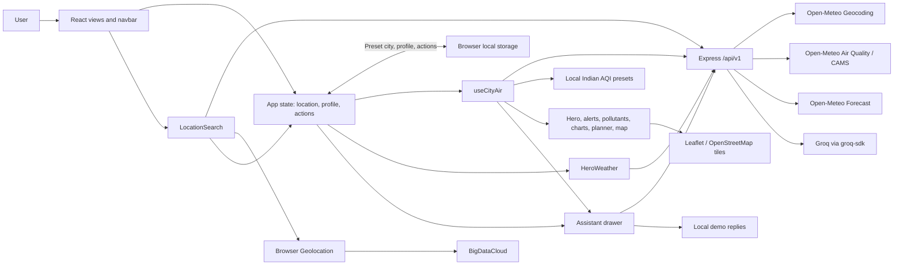

# Urban Air Quality Assistant technical context

## 1. Project identity

Urban Air Quality Assistant is a browser-based dashboard for checking outdoor air quality and planning daily activities around pollution. Urban smog can make it difficult to choose when to travel, exercise, ventilate a home, or move activities indoors. The project brings local AQI, pollutant concentrations, forecast trends, and practical guidance into one place.

The intended audience includes urban residents, commuters, caregivers, and households with children or older adults. The app aims to support informed decisions about exposure and lower-emission habits. The assistant uses scripted advice in demo mode and calls the Groq-backed API in modeled mode. Groq needs a private backend key and project access.

## 2. Technology stack

Versions below are the installed direct dependencies verified against the lockfile. The project uses JavaScript and JSX, with HTML and CSS.

| Area | Implementation |
| --- | --- |
| Frontend | React and React DOM 19.3.1, React Router DOM 7.18.6 with hash routing |
| Development and build | Vite 7.3.8, Vite React plugin 5.2.0, npm lockfile |
| Styling | Tailwind CSS and Tailwind Vite plugin 4.3.5, custom CSS, Inter Variable 5.3.0, Lucide React 0.562.0 |
| Motion | Motion 12.43.0, Web Animations API, Canvas 2D, CSS transitions and media queries |
| Charts | Recharts 3.11.0 |
| Maps | Leaflet 1.9.4 with OpenStreetMap tiles |
| Air quality and weather | Open-Meteo Air Quality using Copernicus CAMS, plus Open-Meteo Forecast |
| Location | Open-Meteo Geocoding using GeoNames, browser Geolocation, BigDataCloud reverse geocoding |
| Assistant | Groq SDK 1.6.0, configurable Groq model, react-markdown 10.1, and local scripted demo |
| Backend | Node.js 24 or 22 LTS, Express 5.3.0, Zod 4.6.7, dotenv 18.0.10, CORS 2.8.6, Helmet 8.3.0, express-rate-limit 8.7.5 |
| Backend verification | Vitest 4.1.12, Supertest 7.3.2, ESLint 9.39.5, Prettier 3.10.1 |
| Backend, database, hosting | Express backend with a bounded memory cache. Browser preferences use local storage. No database or deployment platform is configured |

## 3. System architecture

The Vite entry mounts a React single-page application. Vite proxies same-origin versioned requests to Express on `127.0.0.1:5001` in development and preview. Express calls Open-Meteo and Groq. Browser geolocation, BigDataCloud reverse geocoding, and OpenStreetMap tiles retain their existing browser flow. App state is shared through component props. Searched and detected locations live in memory for the current page session. The preset city, household profile, and selected sustainability actions use the local storage keys `uaqa:city`, `uaqa:profile`, and `uaqa:actions`.



`useCityAir` keys responses by location ID, coordinates, and retry counter. It aborts superseded requests and exposes pending or unavailable data for the current location. The normalizer retains distinct current, earlier modeled, and forecast values. The hero's weather fetch is independent and keyed by coordinates. The assistant consumes the selected city and profile. A reply in flight is discarded if the location or household profile changes, with a retry action using the updated context.

### Routes

| Hash route | View |
| --- | --- |
| `#/` | Overview, hero, compact pollutants, hourly trend and forecast |
| `#/air-quality` | Current AQI, pollutant details and comparisons, hourly and daily charts, category reference |
| `#/map` | Lazy-loaded pollution map and marker search |
| `#/daily-planner` | Household profile and morning, afternoon and evening plans |
| `#/indoor-air` | Filterable, expandable guidance |
| `#/sustainability` | Action checklist, progress and qualitative benefits |
| `#/community` | Sample activities and educational guidance |

The legacy routes `#/daily-plan`, `#/tips`, and `#/impact` redirect to their current counterparts. Notifications and the assistant are available from the navbar.

## 4. Project folder structure

```text
.
├── .gitignore
├── AGENTS.md
├── PROJECT_CONTEXT.md
├── README.md
├── backend/
│   ├── .env.example
│   ├── .gitignore
│   ├── .prettierrc
│   ├── README.md
│   ├── package.json
│   ├── package-lock.json
│   ├── eslint.config.js
│   ├── vitest.config.js
│   ├── src/
│   │   ├── app.js
│   │   ├── config.js
│   │   ├── errors.js
│   │   ├── assistantTools.js
│   │   ├── groq.js
│   │   ├── providers.js
│   │   ├── routes.js
│   │   ├── server.js
│   │   └── validation.js
│   └── tests/
│       └── api.test.js
├── index.html
├── package.json
├── package-lock.json
├── vite.config.js
├── public/
│   ├── assets/
│   │   └── skyline.jpg
│   └── images/
│       └── aqi-states/
│           ├── good.png
│           ├── moderate.png
│           ├── sensitive.png
│           ├── unhealthy.png
│           ├── very-unhealthy.png
│           └── hazardous.png
└── src/
    ├── main.jsx
    ├── App.jsx
    ├── styles.css
    ├── components/
    │   ├── AirEnvironment.jsx
    │   ├── AirHero.jsx
    │   ├── AtmosphereCanvas.jsx
    │   ├── Dashboard.jsx
    │   ├── HeroWeather.jsx
    │   ├── LocationSearch.jsx
    │   ├── PollutionMap.jsx
    │   ├── PollutionParticles.jsx
    │   └── PollutionStreaks.jsx
    ├── data/
    │   ├── api.js
    │   ├── air.js
    │   ├── airScenes.js
    │   ├── guidance.js
    │   ├── locations.js
    │   └── openMeteo.js
    └── hooks/
        ├── useAtmosphereMotion.js
        └── useCityAir.js
```

`src/main.jsx` mounts routing and Motion. `src/App.jsx` owns shared state and route composition. `vite.config.js` registers the React and Tailwind plugins and splits React and chart bundles and proxies the local API. `backend/src/app.js` creates Express, `routes.js` contains the small request handlers, `validation.js` holds schemas and middleware, `errors.js` owns the error envelope, and `providers.js` and `groq.js` hold integrations. The six PNGs are active hero artwork. The JPEG is present with no source reference found. The active skyline is SVG in `AirEnvironment.jsx`. Generated `node_modules/` and `dist/` are ignored and omitted from the tree.

## 5. Feature inventory

Paths in this table are relative to the project root.

| Feature | Status and behavior | Source |
| --- | --- | --- |
| Dashboard and alerts | Implemented. Current category, exposure guidance, PM readings, short forecast, navigation and local alerts | `src/App.jsx`, `src/components/AirHero.jsx`, `src/components/Dashboard.jsx` |
| Search and location | Implemented. Worldwide provider search, keyboard input, mobile panel, preset cities and opt-in device location | `src/components/LocationSearch.jsx`, `src/data/locations.js` |
| Current air quality | Implemented via provider-modeled estimates. Five Indian demo snapshots are explicitly fictional | `src/hooks/useCityAir.js`, `src/data/openMeteo.js`, `src/data/air.js` |
| Pollutants | Implemented for PM2.5, PM10, NO₂, O₃, CO and SO₂ where available. Demo CO and SO₂ are absent | `src/data/air.js`, `src/components/Dashboard.jsx` |
| Weather | Implemented. Temperature, condition, humidity, wind and hourly UV where available. Glass card has a solid-tint fallback | `src/components/HeroWeather.jsx`, `src/styles.css` |
| Six AQI stages, palettes and character states | Implemented for both displayed scales. Scene falls back to unavailable when the reading is missing. Modeled values above 500 retain the reading and use the Hazardous scene | `src/data/airScenes.js`, `src/components/AirHero.jsx`, `public/images/aqi-states/` |
| Clouds and variable speed | Implemented with three repeated SVG tracks, severity-dependent density and playback rate easing | `src/components/AirEnvironment.jsx`, `src/hooks/useAtmosphereMotion.js` |
| Haze and skyline | Implemented. Haze intensifies and skyline opacity declines as severity increases | `src/components/AirEnvironment.jsx`, `src/styles.css` |
| Floating dust and falling streaks | Implemented as distinct animated canvases with mobile counts and reduced-motion fallback | `src/components/PollutionParticles.jsx`, `src/components/PollutionStreaks.jsx`, `src/components/AtmosphereCanvas.jsx` |
| Assistant | Scripted in demo. Modeled mode calls Groq through Express with server-fetched context. The transcript stays in browser memory. The last four completed exchanges are sent to Groq as native user/assistant messages with current server-fetched context. New conversation clears the transcript. Markdown skips raw HTML and images | `src/components/Dashboard.jsx`, `src/data/guidance.js`, `src/App.jsx` |
| Daily planner | Implemented. Uses the available peak hourly AQI in each time window and the selected household profile. Refresh requests a structured Groq plan in modeled mode and retains a labeled local plan on error | `src/data/guidance.js`, `src/components/Dashboard.jsx`, `src/App.jsx` |
| Indoor air and sustainability | Deterministic API recommendations, local guide fallback, and a persistent action checklist | `src/data/guidance.js`, `src/components/Dashboard.jsx`, `src/App.jsx` |
| Charts and forecasts | Implemented. Hourly trends, daily forecast peaks when available and pollutant comparison | `src/data/openMeteo.js`, `src/components/Dashboard.jsx` |
| Map | Implemented. Selected location and preset markers. Search is limited to those markers. Tiles come from OpenStreetMap | `src/components/PollutionMap.jsx` |
| Community | Sample content. Activities are local fixtures with no booking or event feed | `src/data/guidance.js`, `src/App.jsx` |
| Responsive layout | Implemented with responsive navbar, hero, cards, search and assistant drawer | `src/styles.css`, `src/App.jsx` |

## 6. AQI visualization system

Severity uses category position within the active standard. Indian demo readings and modeled US readings are never converted into one another. US Hazardous is displayed as 301+ by the category reference. The six scene definitions are bounded to 0–500. A modeled reading above 500 keeps its full value and uses the Hazardous scene. Missing readings suppress the scene.

| US AQI | Indian National AQI | Character PNG | Sky / horizon | Cloud loops back / mid / front | Dust / streaks | Haze / skyline opacity |
| --- | --- | --- | --- | --- | --- | --- |
| 0–50 Good | 0–50 Good | `good.png` | `#59BDF4` / `#B9E7FA` | 80 / 67.5 / 55 s | 0 / 0 | .02 / .66 |
| 51–100 Moderate | 51–100 Satisfactory | `moderate.png` | `#D9AD72` / `#F0D6A7` | 65 / 55 / 45 s | 8 / 0 | .12 / .51 |
| 101–150 Unhealthy for Sensitive Groups | 101–200 Moderately Polluted | `sensitive.png` | `#E99779` / `#F4C1A4` | 50 / 42.5 / 35 s | 20 / 10 | .22 / .42 |
| 151–200 Unhealthy | 201–300 Poor | `unhealthy.png` | `#D76C8D` / `#8E4A57` | 40 / 34 / 28 s | 35 / 22 | .36 / .29 |
| 201–300 Very Unhealthy | 301–400 Very Poor | `very-unhealthy.png` | `#97639E` / `#49304F` | 30 / 26 / 22 s | 55 / 38 | .53 / .18 |
| 301–500 Hazardous | 401–500 Severe | `hazardous.png` | `#754653` / `#241B25` | 22 / 19 / 16 s | 75 / 55 | .72 / .08 |

`airScenes.js` owns the scene settings. The hero loads the current PNG on demand and preloads all six only in the development simulator. It crossfades characters over about 500 ms, and transitions atmospheric colors over about one second. Cloud density ranges from two to seven configured formations and varies by layer. Track copies make cloud loops seamless. The playback rate eases over 900 ms while preserving the cloud's current position. The dust and streak canvases ease density and speed without React renders per frame. At widths of 580 px or less, counts use approximately 52% of their desktop targets, rounded up. Canvas pixel density is capped. Effects sit behind the character, weather card and AQI text and ignore pointer events.

Offscreen and hidden-tab rendering pauses where supported. Reduced-motion mode pauses clouds, hides animated particles, and retains a static haze. Animation speed, haze and streaks are artistic severity cues. The weather API supplies modeled precipitation. The hero has no weather-driven rain renderer.

The AQI simulator is disabled by default. Set `VITE_ENABLE_AQI_SIMULATION=true` on the Vite development server to enable the exact value, slider, AQI standard and atmosphere statistics. The simulator affects only the hero. Production builds exclude the panel even with the flag set.

## 7. APIs and integrations

| Integration | Request and data flow | Failure behavior | Configuration and status |
| --- | --- | --- | --- |
| Open-Meteo Air Quality / CAMS | `useCityAir` calls Express, which requests Open-Meteo `/v1/air-quality` with coordinates, local timezone, current US AQI and pollutants, plus four days of hourly AQI. The normalizer groups future hours into daily peaks | Abort superseded requests. A failed current-location request shows unavailable data and a retry button. Missing fields remain missing | Live model queries. No application key configured |
| Open-Meteo Forecast | `HeroWeather` calls Express, which requests `/v1/forecast` for current and hourly weather including precipitation and UV | Unavailable or partial readings stay labeled. Failed requests offer retry | Live model queries. No application key configured |
| Open-Meteo Geocoding / GeoNames | Location search debounces 300 ms and requests up to eight results through Express. The selected coordinates drive air quality and weather | Aborts older searches. Handles empty results and offers retry for provider failure | Live public endpoint |
| Browser Geolocation and BigDataCloud | User action requests permission. Coordinates drive air and weather requests and the browser sends them to BigDataCloud for a readable locality | Denial or timeout leaves manual search available. Reverse lookup failure keeps the coordinates and the “Current location” label | Browser permission and secure context, such as HTTPS or localhost. Device coordinates stay in memory |
| OpenStreetMap tiles | Leaflet fetches public tiles directly and displays attribution | Tile failures surface a message. Markers and search remain usable | Live public tiles |
| Assistant and planner | Explicit action calls the server in modeled mode. Groq receives validated input and trusted provider context, with raw coordinates omitted from prompt fields | Handles missing key, model errors, rate limits, timeouts and invalid output. Planner displays local guidance on failure | Live chat and structured planner were verified with the configured model. Groq serves `openai/gpt-oss-120b` with no automatic generation retries. Demo uses local guidance |

See the [backend integration guide](backend/README.md) for API routes, envelopes, setup and limits. Requests pass through Helmet, restricted CORS, a body limit, rate limiting and Zod. Only environmental and search results are cached. Preserve attribution in each live view. External API access and browser location permission are subject to provider and client availability.

## 8. Development setup

Use Node.js 24 LTS or 22.12+ in the Node 22 LTS line. From the root, run `npm ci` and `npm --prefix backend ci`. Start `npm --prefix backend run dev` and `npm run dev` in separate terminals. The frontend build is `npm run build` and Vite preview is `npm run preview`. Backend checks are `npm --prefix backend test`, `npm --prefix backend run lint`, and `npm --prefix backend run format:check`.

See [backend setup](backend/README.md) for `PORT`, `NODE_ENV`, `FRONTEND_ORIGIN`, `CACHE_TTL_MS`, `AI_PROVIDER`, `GROQ_MODEL`, and private `GROQ_API_KEY`. Set `VITE_API_BASE_URL` only when the frontend uses a direct backend URL in place of the same-origin proxy.

## 9. Current development status

Groq chat uses automatic local function calling for `searchLocation`, `getAirQuality`, `getWeather`, `getAirQualityForecast`, and `compareCities`. Tool arguments pass an allowlist and Zod validation. Named cities resolve via the existing cached Open-Meteo providers. Ambiguous locations return candidates, and comparisons can return partial results. Tool output includes source, units, modeled status and AQI standard where applicable. Coordinates are used internally for requests. Chat preserves the existing four completed exchanges and leaves dashboard selection intact.

For a single-city ambiguity, the chat response can return a validated pending location and lookup type. The client keeps this with the latest assistant turn and sends it on the next request. An affirmative answer resolves the place and retrieves Open-Meteo data directly, without consuming a Groq completion. A narrow compatibility parser handles plain-text suggestions in existing history. The resolved place is tracked separately from dashboard location and reused when a follow-up tool asks for the same city without qualifiers. Duplicate tool requests within a turn reuse the first result. Provider logs record only phase, HTTP status and known error code, while client errors remain sanitized.

The live browser verified Delhi confirmation, follow-up city memory, a Bengaluru/Mumbai comparison, a standalone Bengaluru lookup while Mumbai stayed selected, and a Groq cooldown message. Before the fix, a short replay succeeded and a full-context replay reached the provider's token-per-minute limit. The exact original provider response behind the generic error was unavailable. The textarea uses a rounded container focus ring with native resizing disabled.

The GPT-OSS 120B workflow is sequential. Chat allows two tool rounds and at most three Groq completions, with a 25-second deadline after dashboard context is fetched. General questions can complete in one call. A comparison covers two or three cities. The live API test observed Groq selecting `getAirQuality` for Bengaluru with Mumbai context. The browser displayed Bengaluru’s modeled US AQI while the hero stayed on Mumbai. Automated tests cover all five tools, invalid arguments, disambiguation, partial results and the round limit.


Groq is the sole configured AI provider. Live verification confirmed the account lists GPT-OSS 120B as active, a live three-period plan, distinct chat answers, and a browser reply and conversation reset. The provider returned HTTP 429 during the first follow-up sequence. A later live two-turn cycling check carried the commute context into a simpler answer. Advice varied in quality across smoke tests, and these checks do not establish accuracy for every reply. Mocked tests exercised the full sequence, finish reasons, output validation and Retry-After cooldown. Indoor air, sustainability and the hero exposure guidance remain deterministic. Chat and planner can provide personalized advice through Groq on explicit request.

The dashboard loads Open-Meteo/CAMS AQI for the selected coordinates by default. Pending and failed requests clear reading fields and sample metadata. Failures show an unavailable state and a retry action. The map and Compare cities retain labeled comparison snapshots. Scripted demo fixtures for preset locations require the separate development-server flag `VITE_ENABLE_DEMO_DATA=true`.

The preceding dashboard UI check verified default modeled data, London keyboard selection, a forced API failure, all six opt-in simulator stages, mobile search, main route navigation, live Groq chat and planner, and production bundle exclusion of the simulator.

- **Implemented** — Express API, shared AQI categories, provider timeouts and cache, live Open-Meteo search/air/weather, deterministic recommendations, and Groq chat and structured planner integration.
- **Automated checks passed** — 52 backend tests with mocked providers, backend ESLint and Prettier checks, and the Vite production build on Node.js 24.
- **Live local checks passed** — All eight endpoints through the Vite development proxy, including Open-Meteo location search, air quality and weather, plus Groq chat and structured planner generation. The migration checks ran on loopback-only development instances.
- **Browser checks passed** — Keyboard selection of London, modeled AQI and forecasts, live mobile Groq chat and clearing the conversation.
- **Pending** — Public deployment, authenticated AI access, CI and broader browser automation. Geolocation permission, physical devices and a full accessibility review remain outside this check.
- **Limits** — Per-process cache and rate limits, no persistent conversations, limited map marker search, and no station measurement feed.

### Pre-production audit

Verified locally on 2026-11-24 using Node 24 and the in-app browser. The production build was previewed locally. The application was kept off public hosting.

| Area | Verified result |
| --- | --- |
| Live browser | Dashboard and alerts, seven main routes, keyboard search and selection, map marker filtering and city selection, pollutant and forecast views, household profile, live Groq planner refresh, indoor guide expansion, sustainability action toggle, community samples, and scripted demo chat. The three legacy redirects resolved in production preview. |
| Live providers | London AQI, category, pollutant values, weather fields and daily AQI peaks matched the Open-Meteo responses used in the comparison. The figures are modeled estimates. Groq returned a Bengaluru/Mumbai comparison and a follow-up forecast for the first city. |
| Browser fixtures | AQI and weather outages, unavailable labels and retry controls, search loading and empty states, all six hero stages, and Markdown formatting with raw HTML and remote images omitted. No document horizontal overflow at requested widths of 390, 768 and 1400 px on the tested dashboard. |
| Automated | 52 backend tests, Indian AQI boundary spot checks including all category transitions, lint, formatting, production build, and npm audit on both dependency trees. Both audit reports contained zero known advisories. |
| Security | Verified exact-origin CORS allow and deny behavior, Helmet headers, rate-limit headers, Git ignores for private env files, and absence of the active Groq key from built JavaScript. No matching Groq or Gemini credential patterns were found in the scanned source/history. Reviewed Zod request and tool schemas, fixed provider destinations, bounded tool rounds and sanitized logs. |
| Performance | Production preview observed one character PNG and no Markdown asset on initial dashboard load. The six original PNGs total about 7.3 MiB on disk. Initial gzipped JavaScript fell from about 318 to 282 kB by deferring the Markdown parser. Charts remain the largest initial chunk at about 130 kB gzip. Map stays lazy-loaded. |

The audit fixed the default local preview CORS allowlist for port 4173 and verified both loopback origins with isolated POST requests. The current private config overrides the allowlist and rejected port 4173 during testing. Add the exact preview origin to that override when previewing API-backed interactions. Map marker labels now use a text node instead of HTML assembly. The pollutant formatter is reused, and the Groq prompt discourages inferring exposure or risk ratios from AQI values. A live retest selected compareCities and returned both cities’ AQI values and categories without a ratio.

Public launch still requires access controls for quota-backed AI routes, proxy-aware and shared abuse limits for a multi-instance deployment, and the production host's HTTPS, frontend CSP and observability configuration. CORS is a browser control. Groq can still produce weak advice and exhaust quota under concurrency. Review Open-Meteo commercial usage terms, OpenStreetMap tile policy, and code and artwork licensing before release. Further verification includes actual device geolocation and reverse geocoding, reduced-motion and screen-reader checks, cross-browser and physical-device coverage, and a production-like load test and React profile. The map tile service and environmental forecasts are externally dependent.

### Single-instance pilot preparation

Production chat and planning now require a 30-minute anonymous session bound to the approved frontend origin and client IP bucket. The API applies session issuance, per-IP and per-session limits and a per-process Groq completion budget shared across both routes and their tool follow-ups. Two completion slots are available. The browser obtains a session lazily and refreshes once on explicit expiry. Quota responses do not trigger automatic generation retries. The existing JSON cap and schema validation are retained, and the HTTP listener bounds header and body receipt.

The target is direct Vercel-to-Render HTTPS. Production Express trusts one ingress hop and requires an allowlisted HTTPS frontend for AI, forwarded HTTPS and a valid forwarded client address. Local health remains available to Render probes. Production builds add a CSP for bundled assets, the exact API origin, map tiles and reverse geocoding. Vercel supplies anti-framing and browser security headers. Backend stdout logging uses request IDs, route templates, status, error code and latency, without logging request content or credentials. See [DEPLOYMENT.md](DEPLOYMENT.md).

Verified locally on 2026-11-24 with 58 backend tests, including production ingress simulation, signed sessions, cross-route and tool-follow-up budgets and request limits. A mocked frontend check covered renewal and Retry-After. Standard and hosted-origin builds passed. The Chromium preview loaded the hero PNG, bundled font and 12 map tiles under CSP. Keyboard skip and mobile search worked with no CSP violations observed in that smoke test. A bounded loopback load check at concurrency eight returned 40/40 public API successes and two successes plus 22 rate-limited responses from 24 AI attempts. Peak mock Groq concurrency was two; no external quota was used. Local p95 for the fixture batches was about 29 ms and is not a hosted latency estimate.

Public pilot prerequisites include verifying Render's actual forwarding headers and TLS, Vercel production headers, cold-start behavior, and the live hosted session flow. Asset redistribution rights and a privacy notice remain to be resolved. Physical geolocation, other browser engines and a full accessibility audit were not verified. Anonymous limits constrain total use but cannot reserve quota for individual people under distributed abuse. Per-process counters and tokens reset on restart. The free plans are intended for low-volume noncommercial use and lack production availability guarantees.

### Render listener verification

A failed Render port scan reported port 5001 on localhost. That listener matches the previous development branch rather than the production wildcard binding. Render startup now uses `RENDER=true` to force production mode, reads deployment variables directly from the process, requires a runtime `PORT`, and reports the actual socket address. Local development retains the 5001 fallback. Verified both explicit production and simulated Render startup with `PORT=10000`: the server bound to `0.0.0.0`, and the internal HTTP health probe returned 200 through both loopback and a non-loopback host interface. Other plain HTTP API traffic remained blocked. The 61-test backend suite passed. The hosted revision and runtime settings have not been independently inspected.

### Render origin and bind-error diagnostics

The exact Vercel origin `https://urban-air-quality-assistant-pi.vercel.app` passes strict production validation. Invalid origin entries now receive a formatting hint without echoing the configured value. Local startup on occupied port 10000 reproduced the null-address crash: Express 5 sent the native listen error to the callback, and the callback treated it as a success. Native HTTP listeners now handle startup errors and successful bindings separately. The same occupied port reports `EADDRINUSE`; production startup on port 10002 passed the wildcard bind, internal health and exact-origin CORS checks. The original Render dashboard value and deployed revision were not inspected. The backend regression suite passed 69 tests.

### Hosted weather recovery

The deployed weather card displayed unavailable for New Delhi and Mumbai. The live Render weather route returned `503 PROVIDER_ERROR` on warmed requests while health and AQI returned 200 and the equivalent Open-Meteo Forecast query returned valid data directly. The provider adapter's specific status mapping identifies an upstream 429. The quota bucket that triggered it was not independently visible.

The card still uses the backend first. On that specific weather provider response it makes one bounded, credential-free browser request to the official Open-Meteo Forecast endpoint for the current location. Failed or canceled requests keep the existing unavailable state and retry behavior. The production CSP allows only the exact weather origin for this connection. The API and Groq weather tool continue using the backend path. The built frontend was tested under its CSP with a simulated backend throttle and live forecasts in both cities. The backend suite passed 74 tests. The running deployment has not received the patch.

## 10. Development history

The available Git baseline records the original frontend. This update adds Express and moves Open-Meteo calls behind a versioned API while retaining the existing React application and atmospheric visuals. The browser still controls device location permission. Groq uses a private server-side setting. The existing demo tools remain separate from the modeled-data path.

## 11. Future roadmap

| Priority | Proposed work |
| --- | --- |
| Medium | Add authenticated access and production abuse controls before public exposure. Add CI and browser automation |
| Low | Expand device tests and verify repository and asset licensing |

## 12. AI development handoff

Read [AGENTS.md](AGENTS.md), inspect the relevant backend and frontend code, and preserve the existing demo and live labels. Keep provider access in the backend services, credentials server-side, and schemas and error envelopes consistent. Use `air.js` for classification and `airScenes.js` for visualization. Test both success and failure paths before updating the [README](README.md) and this document.

## 13. Last updated

**2026-11-24** — Added anonymous AI abuse controls and a deployment runbook, and verified the production configuration locally.
